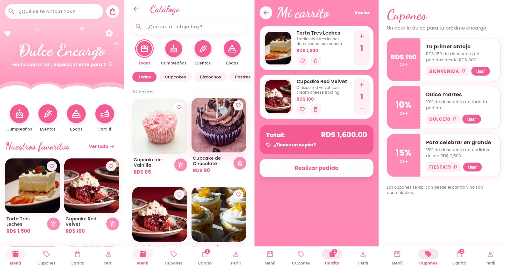
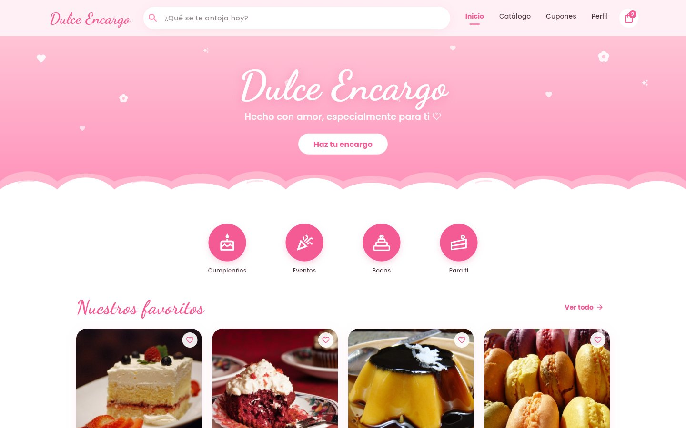
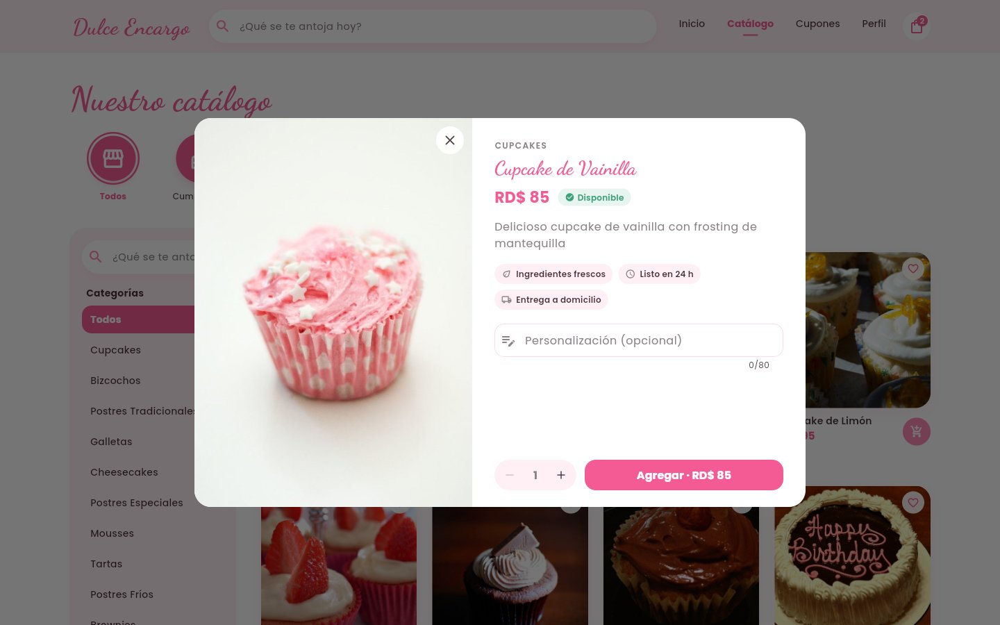
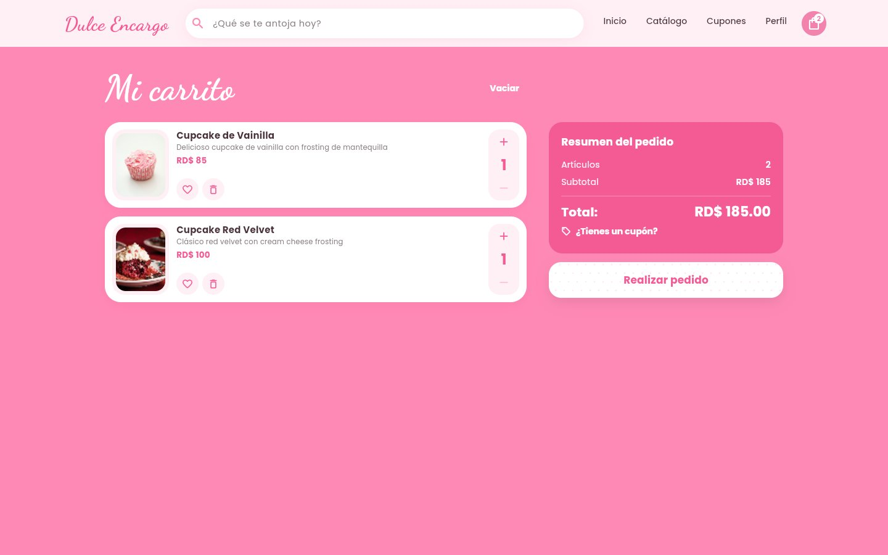

# Dulce Encargo 🧁

Aplicación de pedidos para una repostería artesanal, hecha con **Flutter**.
Catálogo de 62 postres, carrito, cupones, favoritos e historial. Los pedidos
se envían por **WhatsApp**. Funciona sin conexión y se adapta a celular,
tablet y escritorio.

🔗 **Demo en vivo:** https://dulce-encargo.web.app/




| Inicio | Detalle de producto | Carrito |
|---|---|---|
|  |  |  |

## Funcionalidades

- **Catálogo**: búsqueda que ignora acentos, filtros por ocasión (Cumpleaños,
  Eventos, Bodas, Para ti) y por categoría, cuadrícula de 2 a 4 columnas.
- **Detalle de producto**: cantidad y nota de personalización.
- **Carrito**: cambiar cantidades, deshacer al eliminar, favoritos y cupones
  de descuento con compra mínima.
- **Pedido**: formulario con validación, entrega o recogida, fecha y hora,
  mensaje para el pastel y resumen antes de enviar.
- **WhatsApp**: se genera un mensaje con todo el pedido. El pedido queda
  pendiente de confirmación; la app no procesa pagos.
- **Historial**: filtros por estado, estadísticas, top 5 de productos y
  opción de duplicar un pedido anterior.
- **Perfil**: datos de entrega guardados, favoritos y créditos de las fotos.
- **Sin conexión**: carrito, pedidos y favoritos se guardan en el dispositivo
  con Hive.
- **Pantalla de depuración** para revisar la base de datos local.

## Tecnologías

| | |
|---|---|
| Framework | Flutter 3 · Dart 3 · Material 3 |
| Estado | Provider (`ChangeNotifier`) |
| Base de datos | Hive (NoSQL local) |
| Otros | url_launcher (WhatsApp), Firebase Hosting |

## Estructura

```
lib/
├── data/          # catálogo, cupones y créditos de imágenes
├── models/        # Producto, Pedido
├── navigation/    # AppShell: navegación responsive
├── providers/     # CarritoProvider (carrito, favoritos, cupones, historial)
├── screens/       # inicio, catálogo, carrito, pedido, cupones, perfil…
├── services/      # base de datos local y mensaje de WhatsApp
├── utils/         # tema, colores, formato y breakpoints
└── widgets/       # tarjetas, decoraciones, encabezado…
```

## Diseño

Paleta: `#FF89B5` rosa · `#F45B95` rosa fuerte · `#FFC4D6` pastel ·
`#FFF0F5` fondo · `#493139` marrón · `#8B8287` gris.
Tipografías **Dancing Script** (títulos) y **Poppins** (texto).
En celular la navegación va abajo (Menú · Cupones · Carrito · Perfil); en
tablet y escritorio, arriba con la búsqueda.

## Cómo ejecutar

```bash
git clone https://github.com/Angelismejia/dulce_encargo_app.git
cd dulce_encargo_app
flutter pub get
flutter run -d chrome        # o flutter run en un emulador / celular
```

El número de WhatsApp se cambia en `lib/widgets/comunes.dart` (`Contacto`).

## Pruebas

```bash
flutter test
```

- **Lógica**: precios, cupones, catálogo y mensaje de WhatsApp.
- **Responsive**: recorre todas las pantallas a 320, 390, 820 y 1440 px y
  falla si algo se desborda.

## Despliegue

```bash
flutter build web --release
npx firebase deploy
```

## Créditos

Fotos de [Openverse](https://openverse.org) con licencias abiertas (CC BY,
CC BY-SA, CC0). Autores en [`assets/images/CREDITOS.md`](assets/images/CREDITOS.md)
y dentro de la app (Perfil → Créditos de las fotos). Fuentes bajo licencia SIL OFL.

---

Hecho por [Angelismejia](https://github.com/Angelismejia)
